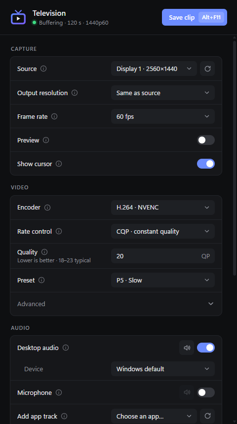

# Television

A lightweight, vibe-coded replay buffer for Linux: a ShadowPlay alternative with most of the video settings you'd find in OBS. It runs on NVIDIA GPUs, keeps the last N seconds of your screen, and saves them as a clip when you press a hotkey (default **Alt+F10**).



## Features

- **Sources:** a whole screen or one window, picked once in the system's screen-sharing dialog and remembered from then on (Wayland, through the desktop portal).
- **Video:** H.264 or HEVC on NVENC, with OBS-style quality settings and optional downscaling.
- **Audio:** separate tracks for desktop audio, the microphone and individual apps, plus a mixed track, all through PipeWire. Each one can be muted live.
- **Buffer:** in RAM or on disk. It's built to run for days without audio drift.
- **Extras:** tray icon, start on login, a global hotkey that works on KDE Wayland whatever has focus, and a live preview of what's being recorded.

## Requirements

- A Wayland session with xdg-desktop-portal (made for KDE Plasma 6; GNOME and others with a ScreenCast portal should work too).
- PipeWire.
- An NVIDIA GPU with the proprietary driver, and FFmpeg built with NVENC (Arch and CachyOS ship it that way).

## Build

On Arch / CachyOS:

```bash
sudo pacman -S --needed rustup ffmpeg pipewire webkit2gtk-4.1 libayatana-appindicator xdg-desktop-portal
```

```bash
rustup default stable
```

```bash
./install.sh
```

That builds it and installs it for your user under `~/.local` (app launcher entry included); run it again to update, or `./install.sh --uninstall` to remove it. `cargo run --release` runs it from the source folder instead, and `npx @tauri-apps/cli@2 build` builds .deb and .rpm packages.

The first start opens the system's screen-sharing dialog: pick a screen (or a window) and allow restoring, and Television remembers it from then on.

## Known limitations

- NVIDIA only.
- No "Automatic" source: Wayland doesn't let apps see which window is focused, so the Windows version's "record the fullscreen game, else the desktop" mode isn't possible. Pick the screen the game runs on.
- Frames stay on the GPU (DMA-BUF from the compositor, scaled in OpenGL, encoded from CUDA), so capture costs almost no CPU. If the compositor can't share DMA-BUFs with the NVIDIA GPU (e.g. it renders on another GPU), Television falls back to frames in system memory, which costs CPU, more so when downscaling. `TELEVISION_NO_DMABUF=1` forces that fallback.
- The global hotkey uses KDE's shortcut service. On other desktops it falls back to an X11 key grab, which only fires while an XWayland window is focused.

## License

[MIT](LICENSE). Uses FFmpeg (LGPL/GPL, from your system) and PipeWire.
